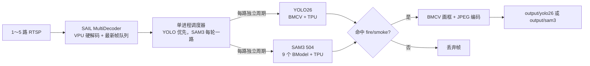

# BM1684X 多路 RTSP 火焰/烟雾检测

面向 16GB 内存、64GB eMMC 的 BM1684X SoC 盒子。服务原生运行，不使用 Docker；最多接入 5 路 RTSP，可按配置启用 YOLO26、SAM3 或同时启用两者。各模型有独立检测周期，只有命中火焰/烟雾时才保存带框 JPEG，并按模型分目录。

本实现对齐 [sophgo/sophon-demo `release@dfe0dff`](https://github.com/sophgo/sophon-demo/tree/dfe0dff31c21984b681536df9cb2b1ba6c96a8a4)，复用其中官方 YOLO26 BMCV 和 SAM3 Python 推理实现，不复制、魔改官方算法源码。

## 1. 设计与执行方式



关键取舍：

- `MultiDecoder(queue_size=2, discard_mode=1)` 让底层持续硬解码，队列满时丢弃旧帧。即使几秒才检测一次，也不会顺序处理积压视频。
- TPU 推理串行执行，避免 YOLO26 与 9 段 SAM3 同时争用 BM1684X。先清空到期 YOLO 任务，再执行一个 SAM3 任务，然后重新检查 YOLO。
- YOLO26 使用官方 `yolo26_bmcv.py`：色彩转换、缩放、归一化由 BMCV 完成，BModel 在 TPU 上执行。
- SAM3 的 ViT、Neck、Text Encoder、Grounding Encoder/Decoder 均为 BModel；文本提示只在启动时编码一次。
- SAM3 必须把一帧转成 BGR NumPy 供官方预处理使用，使用的是 SAIL `BMImage.asmat()`；其余重计算仍在 TPU。
- 项目在创建 SAM3 pipeline 前替换官方 NumPy mask decoder，因此不会加载 mask head，也不会计算或保存 mask。只保留框和分数。
- 检测框绘制与 JPEG 保存都由 BMCV 完成。保存有可配置冷却时间和磁盘剩余空间保护，适合 24×7 和 64GB eMMC。

### 硬件加速覆盖

| 环节 | 实现 |
|---|---|
| RTSP H.264/H.265 解码 | SAIL MultiDecoder / Sophon FFmpeg，VPU |
| YOLO26 前处理 | BMCV |
| YOLO26 推理 | BM1684X TPU，建议 INT8 1 batch |
| SAM3 ViT/Neck/Text/Grounding | BM1684X TPU，FP16 504×504 |
| SAM3 框后处理 | NumPy CPU；计算量很小 |
| SAM3 mask | 完全禁用 |
| 画框、JPEG 编码 | BMCV |

## 2. 目录

```text
config/
  config.example.yaml       完整配置示例
  fire_smoke.names          YOLO 类别顺序示例
deploy/
  fire-smoke-monitor.service
src/fire_smoke_monitor/
  config.py                 强校验配置
  streams.py                MultiDecoder RTSP 通道
  models.py                 官方 YOLO26/SAM3 适配器
  scheduler.py              固定延时、YOLO 优先调度
  writer.py                 BMCV 画框和保存
  app.py / cli.py           生命周期和命令行
tests/                       不依赖算能硬件的配置/调度测试
```

## 3. SoC 原生环境

环境准备文档：

- 设备仍是较旧 SophonSDK 时，参见 [BM1684X SoC 在线升级 SDK v26.03.01](docs/BM1684X_SDK_26.03.01_OTA_UPGRADE.md)。
- SDK v26.03.01 缺少匹配的 SAIL Python 运行时时，参见 [SAIL v3.11.1 面向 BM1684X SDK v26.03.01 的交叉编译记录](docs/SAIL_3.11.1_BM1684X_SDK_26.03.01_CROSS_COMPILE.md)。

### 3.1 版本要求

- BM1684X SoC，设备号通常为 `0`。
- Python 3.8+。
- libsophon 0.5.3+。
- sophon-sail 3.9.0+；建议使用 3.11.1 或盒子厂商已验证的新版本。
- 与 libsophon 匹配的 sophon-ffmpeg、sophon-opencv。
- NumPy 1.24+、PyYAML 6.x。

不要用 pip 安装普通 `opencv-python` 覆盖 SoC 自带的 Sophon OpenCV，也不要从 PyPI 猜测安装 `sophon-sail`。驱动、运行时、SAIL、FFmpeg 和 OpenCV 应来自同一版算能 SDK/盒子系统镜像。

SDK v26.03.01 SoC 镜像中的 Python 绑定实测位于以下目录；先加入当前 shell 的模块搜索路径：

```bash
export PYTHONPATH=/opt/sophon/sophon-opencv-latest/opencv-python${PYTHONPATH:+:$PYTHONPATH}
```

先验证硬件环境：

```bash
python3 - <<'PY'
import sophon.sail as sail
import cv2
import numpy
h = sail.Handle(0)
print("target:", h.get_target())
print("opencv:", cv2.__version__)
print("numpy:", numpy.__version__)
PY
```

`target` 应包含 `BM1684X`。

### 3.2 准备官方 sophon-demo

```bash
sudo mkdir -p /opt
cd /opt
sudo git clone --branch release https://github.com/sophgo/sophon-demo.git
cd sophon-demo
sudo git checkout dfe0dff31c21984b681536df9cb2b1ba6c96a8a4
```

固定提交很重要：本项目调用了该提交下的 `sample/YOLO26/python/yolo26_bmcv.py` 和 `sample/SAM3/python/sam3_infer.py` 接口。以后升级 sophon-demo 时，应先在测试机验证接口和精度。

### 3.3 安装本服务

把本仓库放到 `/opt/fire-smoke-monitor`，然后：

```bash
cd /opt/fire-smoke-monitor
python3 -m venv --system-site-packages .venv
. .venv/bin/activate
python -m pip install 'PyYAML>=6,<7'
python -m pip install --no-deps -e .
cp config/config.example.yaml config/config.yaml
chmod 600 config/config.yaml
```

`--system-site-packages` 用来复用系统中与硬件 SDK 匹配的 `sophon.sail`、Sophon OpenCV 和 NumPy。

## 4. YOLO26：训练、导出、转换和使用

火焰/烟雾不是 COCO 标准类别，官方通用 `yolo26s` 只能用于验证部署链路；实际项目必须用自己的火焰/烟雾数据训练或微调。算能官方例程对齐 Ultralytics 8.4.9，ONNX 导出要求 opset 13，详见[官方 YOLO26 README](https://github.com/sophgo/sophon-demo/tree/dfe0dff31c21984b681536df9cb2b1ba6c96a8a4/sample/YOLO26)。

### 4.1 训练

训练建议在有 GPU 的 x86 工作站完成，不要在 SoC 盒子上训练。数据集结构按 Ultralytics detect 数据集，例如：

```yaml
# fire_smoke.yaml
path: /data/fire_smoke
train: images/train
val: images/val
names:
  0: fire
  1: smoke
```

示例命令：

```bash
python3 -m venv .venv-yolo
. .venv-yolo/bin/activate
pip install 'ultralytics==8.4.9' onnx
yolo detect train model=yolo26s.pt data=fire_smoke.yaml imgsz=640 epochs=100 batch=16
```

训练完成后应在独立测试集检查火焰、云雾、蒸汽、灯光、夕阳等易误报场景。项目只负责部署，不会弥补数据集偏差。

### 4.2 导出 ONNX

```python
from ultralytics import YOLO

model = YOLO("runs/detect/train/weights/best.pt")
model.export(format="onnx", opset=13, imgsz=640, batch=1)
```

得到 `best.onnx`。保持 1 batch；本项目是低频多路调度，1b 占用更小、延迟更直接。

### 4.3 转成 BM1684X BModel

转换应在安装了 TPU-MLIR 的 x86 编译机完成，不应占用 64GB eMMC 盒子的空间。先下载官方 ONNX/qtable 资源或将自己的 ONNX 放到例程目录：

```bash
cd /opt/sophon-demo/sample/YOLO26
./scripts/download.sh --onnx
cp /path/to/best.onnx models/onnx/yolo26s.onnx
```

准备 128～1000 张有代表性的火焰、烟雾及难负样本图片到 `datasets/fire_smoke_cali/`。量化集不需要标签，但必须覆盖真实摄像机、昼夜、天气和码流画质。

在已执行 TPU-MLIR `envsetup.sh` 的 shell 中：

```bash
cd /opt/sophon-demo/sample/YOLO26/scripts

model_transform.py \
  --model_name fire_smoke_yolo26s \
  --model_def ../models/onnx/yolo26s.onnx \
  --input_shapes '[[1,3,640,640]]' \
  --mean 0.0,0.0,0.0 \
  --scale 0.0039216,0.0039216,0.0039216 \
  --keep_aspect_ratio \
  --pixel_format rgb \
  --mlir fire_smoke_yolo26s_1b.mlir

run_calibration.py fire_smoke_yolo26s_1b.mlir \
  --dataset ../datasets/fire_smoke_cali/ \
  --input_num 128 \
  --part_asymmetric \
  --cali_method percentile9999 \
  --fp_type F32 \
  -o fire_smoke_yolo26s_cali_table

model_deploy.py \
  --mlir fire_smoke_yolo26s_1b.mlir \
  --quantize INT8 \
  --chip bm1684x \
  --quantize_table ../models/onnx/yolo26s_qtable_int8 \
  --calibration_table fire_smoke_yolo26s_cali_table \
  --model fire_smoke_yolo26s_int8_1b.bmodel
```

说明：

- 官方 YOLO26 INT8 使用混合精度 qtable。若微调前后网络结构和层名未变，可先使用官方 `yolo26s_qtable_int8`；仍必须对自定义火烟验证集做 FP32/FP16 与 INT8 精度对比。
- 若 INT8 下降明显，按算能[官方 YOLO26 Calibration Guide](https://github.com/sophgo/sophon-demo/blob/dfe0dff31c21984b681536df9cb2b1ba6c96a8a4/sample/YOLO26/docs/YOLO26_Calibration_Guide.md)为自定义权重重新生成敏感层 qtable，或先部署 FP16。
- FP16 基线可把 `model_deploy.py` 改为 `--quantize F16 --chip bm1684x`，并去掉 calibration/qtable 参数。

在编译机或 SoC 上验证 BModel：

```bash
bmrt_test --bmodel fire_smoke_yolo26s_int8_1b.bmodel --devid 0
```

复制到盒子，并保证类别文件行号与训练的 class id 完全一致：

```bash
sudo mkdir -p /opt/models/yolo26
sudo cp fire_smoke_yolo26s_int8_1b.bmodel /opt/models/yolo26/
printf 'fire\nsmoke\n' | sudo tee /opt/fire-smoke-monitor/config/fire_smoke.names
```

配置：

```yaml
yolo26:
  enabled: true
  bmodel: /opt/models/yolo26/fire_smoke_yolo26s_int8_1b.bmodel
  class_names: ./fire_smoke.names
  target_classes: [fire, smoke]
  conf_threshold: 0.25
  interval_sec: 3
  save_cooldown_sec: 30
```

## 5. SAM3：模型准备、转换和使用

BM1684X SoC 必须使用官方 504×504 完整链路。官方说明 1008 模型 NPU 内存约 3.48GB，超过常见 SE7/BM1684X SoC 可用 NPU 内存；504 模型峰值约 1.6GB。完整链路由 5 个 ViT、1 个 Neck、Grounding Encoder、Grounding Decoder 和 Text Encoder 共 9 个 BModel 组成。

### 5.1 推荐：下载官方预编译 BM1684X_504

官方 `download.sh` 会同时下载 BM1688 和大型 ONNX。64GB eMMC 上建议只取运行必需文件：

```bash
cd /opt/sophon-demo/sample/SAM3
python3 -m pip install dfss
mkdir -p models
cd models

python3 -m dfss --url=open@sophgo.com:sophon-demo/SAM3/BM1684X_504.zip
unzip BM1684X_504.zip
rm BM1684X_504.zip

python3 -m dfss --url=open@sophgo.com:sophon-demo/SAM3/postproc_weights.zip
unzip postproc_weights.zip
rm postproc_weights.zip
```

本项目只需要：

```text
models/BM1684X_504/{vit,neck,grounding}/*.bmodel
models/post_process_weights.npz
```

由于 mask 已在构造 pipeline 时禁用，`seg_head_weights.npz` 可以保留，但运行本项目不读取它；也不需要 `sam3.pt`。

### 5.2 准备 BPE tokenizer 文件

官方 `simple_tokenizer.py` 是独立实现，但仍需要 Meta SAM3 仓库中的 BPE vocabulary：

```bash
cd /opt
sudo git clone --depth 1 https://github.com/facebookresearch/sam3.git sam3-source
test -f /opt/sam3-source/sam3/assets/bpe_simple_vocab_16e6.txt.gz
```

只为运行本项目时不需要安装整个 Meta SAM3 Python 包，也不需要下载 PyTorch checkpoint。

### 5.3 自行转换 SAM3

通常没有必要自行转换。若必须从 checkpoint 重导出，应在大内存 x86 编译机进行：

1. 按 [Meta SAM3](https://github.com/facebookresearch/sam3) 要求申请并下载 `sam3.pt`。
2. 使用 sophon-demo `sample/SAM3/tools/` 导出 504 分辨率的 5 段 ViT、Neck、Grounding Encoder/Decoder 和 Text Encoder ONNX。官方对不兼容算子做了专门 patch，不能直接把整模型交给 TPU-MLIR。
3. 将导出的文件放到官方例程预期的 `models/onnx_504`、`models/onnx_grounding_504` 和 `models/onnx` 目录。
4. 在已安装并激活 TPU-MLIR 的环境执行：

```bash
cd /opt/sophon-demo/sample/SAM3
./scripts/gen_bmodel.sh --res 504 --chip bm1684x --mode f16
```

输出应包含：

```text
models/BM1684X_504/vit/sam3_vit_part0_f16_1b.bmodel
models/BM1684X_504/vit/sam3_vit_part1_f16_1b.bmodel
models/BM1684X_504/vit/sam3_vit_part2_f16_1b.bmodel
models/BM1684X_504/vit/sam3_vit_part3_f16_1b.bmodel
models/BM1684X_504/vit/sam3_vit_part4_f16_1b.bmodel
models/BM1684X_504/neck/sam3_neck_f16_1b.bmodel
models/BM1684X_504/grounding/sam3_grounding_encoder_f16_1b.bmodel
models/BM1684X_504/grounding/sam3_grounding_decoder_f16_1b.bmodel
models/BM1684X_504/grounding/sam3_text_encoder_f16_1b.bmodel
```

`post_process_weights.npz` 是框打分和框精修必需权重。可直接使用官方交付文件；只有重新训练或修改 head 时才应从对应 `sam3.pt` 重新提取。完整导出细节见[算能 SAM3 README](https://github.com/sophgo/sophon-demo/tree/dfe0dff31c21984b681536df9cb2b1ba6c96a8a4/sample/SAM3)。

### 5.4 SAM3 配置

```yaml
sam3:
  enabled: true
  model_dir: /opt/sophon-demo/sample/SAM3/models/BM1684X_504
  postprocess_weights: /opt/sophon-demo/sample/SAM3/models/post_process_weights.npz
  bpe_path: /opt/sam3-source/sam3/assets/bpe_simple_vocab_16e6.txt.gz
  precision: f16
  resolution: 504
  score_threshold: 0.30
  interval_sec: 20
  save_cooldown_sec: 60
  prompts:
    - label: fire
      text: fire
    - label: smoke
      text: smoke
```

`text` 是送给 SAM3 的英文开放词汇提示，`label` 是保存文件名/内部结果使用的短名称。提示在启动时一次性编码；修改配置后需要重启服务。

## 6. 模型开关和调度配置

`enabled` 支持以下三种组合：

| YOLO26 | SAM3 | 行为 |
|---|---|---|
| `true` | `false` | 5 路都只按 YOLO 周期检测 |
| `false` | `true` | 5 路都只按 SAM3 周期检测 |
| `true` | `true` | 每路独立执行两种模型，分别保存 |

两者都为 `false` 会被配置校验拒绝。关闭的模型不会加载，不占相应 TPU/内存资源。目前开关是启动配置，不做热切换；修改后执行 `systemctl restart fire-smoke-monitor`。

周期采用“任务完成后再等待 interval”的固定延时语义，不追赶历史帧。例如 SAM3 推理耗时 2 秒、`interval_sec: 20`，同一路下次约在本次完成 20 秒后执行。这符合低实时性监控需求，也避免故障恢复后爆发式补任务。

建议起点：

- YOLO26：`interval_sec: 3`。
- SAM3：`interval_sec: 20`；5 路都启用时不要设成 3 秒。
- 持续火灾会每次命中。为保护 eMMC，YOLO `save_cooldown_sec: 30`、SAM3 `60`；若必须保存每个命中采样帧，设为 `0`。
- `min_free_disk_gb: 2` 会在磁盘空间不足时停止保存，但继续推理和记录错误日志。

## 7. 启动与 24×7 运行

先修改 `config/config.yaml` 中 RTSP、模型和 BPE 路径。程序不会打印 RTSP URL，避免密码进入日志。

仅检查 YAML 和本地文件：

```bash
cd /opt/fire-smoke-monitor
. .venv/bin/activate
python -m fire_smoke_monitor --config config/config.yaml --check-config
```

前台运行：

```bash
python -m fire_smoke_monitor --config config/config.yaml
```

输出目录：

```text
output/
  yolo26/<camera_id>/YYYY-MM-DD/<timestamp>_<labels>_<id>.jpg
  sam3/<camera_id>/YYYY-MM-DD/<timestamp>_<labels>_<id>.jpg
```

安装 systemd 服务前，按实际用户和安装路径修改 `deploy/fire-smoke-monitor.service`：

```bash
sudo cp deploy/fire-smoke-monitor.service /etc/systemd/system/
sudo systemctl daemon-reload
sudo systemctl enable --now fire-smoke-monitor
sudo systemctl status fire-smoke-monitor
journalctl -u fire-smoke-monitor -f
```

systemd 使用 `Restart=always`，RTSP 单路读失败时程序也会按冷却时间调用 MultiDecoder 重连。SIGTERM/SIGINT 会关闭通道并释放模型。

## 8. 性能与容量预期

- 算能官方数据中，BM1684X 的 SAM3 504 FP16 ViT 理论总耗时约 1.1 秒，完整框检测端到端约 2 秒量级；首次启动还包含模型和 tokenizer 冷启动。实际以盒子 SDK、主频和画面为准。
- 5 路 SAM3、20 秒周期时，若单次约 2 秒，SAM3 平均约占一半串行执行时间；YOLO 会在相邻 SAM3 任务间获得优先级。若出现持续延迟，应增大 SAM3 周期。
- 16GB 系统内存足够运行本工程，但 NPU 内存是另一约束；必须使用 `BM1684X_504`，不要配置 1008 模型。
- 图片容量取决于画面分辨率和火情持续时间。保存冷却与 2GB 磁盘保护只能阻止写满，不替代运维侧的定期归档/清理策略。

## 9. 测试和故障定位

开发机安装测试依赖并运行：

```bash
python -m pip install -r requirements-dev.txt
PYTHONPATH=src pytest -q
```

单测不导入 `sophon.sail`；真正启动应用时才加载硬件模块。

常见问题：

- `No module named sophon.sail`：当前 Python/venv 没看到 SoC SDK 的 SAIL，重新用 `--system-site-packages` 创建 venv。
- 配置检查提示官方文件不存在：`sophon_demo_root` 必须指向仓库根目录，不是 `sample/YOLO26` 子目录。
- SAM3 找不到后处理权重：文件必须命名为 `post_process_weights.npz`；本项目用其父目录构造官方权重搜索路径。
- SAM3 初始化或推理 OOM：确认是 504 FP16，且没有同时运行其他占用 TPU 内存的进程。
- YOLO 一直没有火烟框：先用静态图片运行算能官方 `yolo26_bmcv.py` 验证 BModel、类别顺序和阈值，再检查训练数据。
- SAM3 误报：提高 `score_threshold`，并用项目现场负样本验证提示词；开放词汇模型不能替代现场验收。
- RTSP 反复重连：先用 SoC 自带 Sophon FFmpeg 验证 URL、认证、传输协议和编码格式；不要把含密码的完整 URL粘贴到公开日志。

## 10. 第三方代码边界

本仓库只包含调度和适配代码。运行时动态加载外部 sophon-demo 文件；sophon-demo 自身采用 2-Clause BSD（第三方组件除外）。Ultralytics、Meta SAM3、模型权重和数据集各自受其许可证约束，商用部署前应单独核对。
